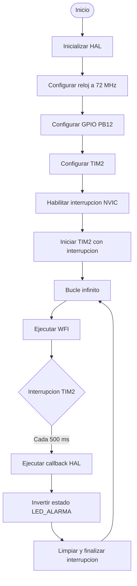

# Tarea: Mi prompt profesional
 
## Funcionalidad elegida
 ### Encender un LED con interrupciones usando un microcontrolador STM32F103
## Version 1: prompt basico
 >Crea un programa para encender un LED.

El resultado fue un codigo en CPP para el modulo Arduino UNO, con indicaciones de la conexion y componentes electronicos necesarios, tabmien incluye un esquema de conexiones.
[Ver resultado aquí](IMG/nivel_1.jpg)

Del codigo adjunto solo se extrae el programa principal.
```cpp
int led = 13; // Pin donde está conectado el LED

void setup() {
    pinMode(led, OUTPUT); // Configurar el pin como salida
}

void loop() {
    digitalWrite(led, HIGH); // Encender el LED
}
```

## Version 2
 >Crea un programa para encender un LED con un microcontrolador STM32F103C8T6.

El resultado muestra los componentes electronicos a usar con imagenes y valores. Seguido muestra un esquema de conexiones ente el microcontrolador, resistencia y LED.
Luego muestra el codigo en C usando las librerias HAL del IDE del fabricante STM Microelectronics. Este codigo incluye una secuencia de encendido y apagado en bucle.
Finalmente se muestra los resultados en forma grafica: el LED encendido y LED apagado.
En otras iteraciones el codigo solo genera en encendido y otros el codigo tipo bare metal (manejando registros del microcontrolador).
[Ver resultado aquí](IMG/nivel_2.jpg)

Del codigo adjunto solo se extrae el programa principal.
```cpp
#include "main.h"

int main(void)
{
    // Inicialización del sistema
    HAL_Init();

    // Configuración del reloj
    SystemClock_Config();

    // Habilitar reloj del puerto GPIOA
    __HAL_RCC_GPIOA_CLK_ENABLE();

    // Configuración del pin PA0
    GPIO_InitTypeDef GPIO_InitStruct = {0};

    GPIO_InitStruct.Pin = GPIO_PIN_0;
    GPIO_InitStruct.Mode = GPIO_MODE_OUTPUT_PP;
    GPIO_InitStruct.Pull = GPIO_NOPULL;
    GPIO_InitStruct.Speed = GPIO_SPEED_FREQ_LOW;

    HAL_GPIO_Init(GPIOA, &GPIO_InitStruct);

    // Bucle principal
    while (1)
    {
        // Encender LED
        HAL_GPIO_WritePin(GPIOA, GPIO_PIN_0, GPIO_PIN_SET);

        HAL_Delay(1000);

        // Apagar LED
        HAL_GPIO_WritePin(GPIOA, GPIO_PIN_0, GPIO_PIN_RESET);

        HAL_Delay(1000);
    }
}
```
## Version 3: prompt final
 >Actua como un programador de microcontroladores. Crea un programa par encender y apagar un LED conectado a un PIN del microcontrolador STM32F103C8T6. Cada encendido y apagado debe durar 500ms, en un bucle sin fin. Debe usarse interrupcione de un temporizador interno para controlar la duracion del encendido y apagado para reducir el uso de la CPU. Usar un PIN de alta corriente. Usa la etiqueta LED_ALARMA para el nombre del LED. Usa las librerias HAL. Define el valor de la resistencia para la salida del PIN. Menciona brevemente los componentes, diagrama de conexiones, diagram de flujo del proceso, explica el codigo y su alternativa usando los registros.

La respuesta muestra todos los items solicitados.
[Enlace compartido del chat](https://chatgpt.com/s/t_6b01e6a7ac9881918326b46318be7e77)

Tambien se generó el diagrama de flujo 


> [!NOTE]
> Parte e la respuesta no estaba solicitada en el promt: el uso de un transistor fue una solucion pero lo que tenia pensado era usar uno de los pines del microcontrolador que soportaran la corriente del LED.

La respuesta incluye una imagen de la integracion de los componentes ([Ver imagen](IMG/circuito_implementado.jpg))

## Componentes del prompt final

| Componente | Texto de mi prompt |
|------------|--------------------|
| Rol | Actúa como un programador de microcontroladores.|
| Instruccion | Desarrolla un programa para encender y apagar un LED conectado a un pin GPIO del microcontrolador STM32F103C8T6.|
| Contexto | El LED debe permanecer encendido durante 500 ms y apagado durante 500 ms en un bucle infinito.|
| Requisitos tecnicos | <ul><li>Utilizar una interrupción de un temporizador interno (Timer) para controlar los intervalos de encendido y apagado.</li><li>Evitar el uso de delays bloqueantes como HAL_Delay().</li><li>Minimizar la intervención del procesador mediante el uso de interrupciones.<li>Utilizar las bibliotecas HAL de STM32.</li></ul>|
| Restricciones | <ul><li>Seleccionar un GPIO con capacidad de corriente suficiente para controlar el LED.</li><li>Utilizar la etiqueta LED_ALARMA como nombre del LED.</li><li>Calcular el valor de la resistencia limitadora de corriente.</li><li>Respetar los límites eléctricos del STM32F103C8T6.</li></ul>|
| Entregables | <ol><li>Lista breve de componentes electrónicos.</li><li>Selección del pin GPIO y justificarlo.</li><li>Cálculo de la resistencia limitadora.</li><li>Diagrama de conexiones.</li><li>Diagrama de flujo del funcionamiento.</li><li>Código completo utilizando STM32 HAL.</li><li>Explicación del código.</li><li>Implementación alternativa utilizando acceso directo a registros (bare metal).</li><ol>|

## Evaluacion del resultado
- El resultado fue muy detallado, entregando mas informacion de lo que se solicitaba.
- Me falto agregar mas espeficiaciones para no externer el promt.
- Tambien se pudo crear un promt para solicitar algunos parametros que se requieran para dar ayor definicion al resultado.
## Errores que evite
Se indico en la restriccion el uso de un nombre para el pin como **LED_ALARMA**.